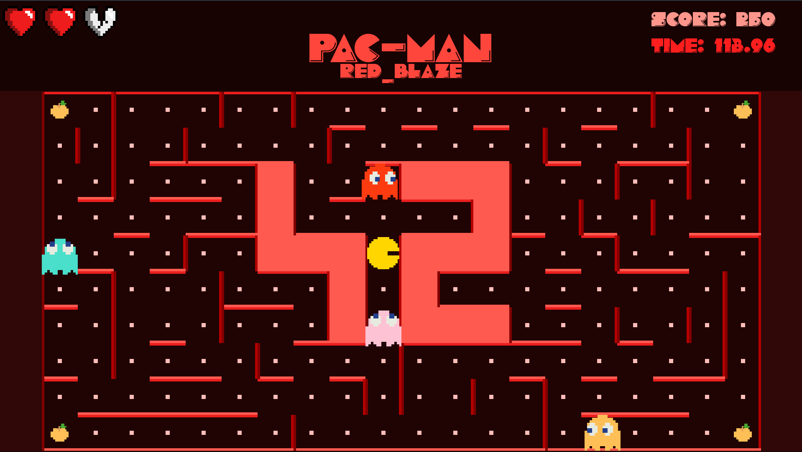

*This project has been created as part of the 42 curriculum by pdauga, flauweri.*

# Pac-Man



## Description

Pac-Man is a Python arcade game built with Pygame. The goal is to clear each maze by collecting its dots while avoiding ghosts. Power pellets let Pac-Man eat ghosts for a short time. Finish levels before the timer runs out, keep your lives, and try to earn a place on the leaderboard.

Features include multiple generated levels, four regular ghost characters and a chance of a secret ghost, score and time tracking, selectable visual themes, and a persistent leaderboard.

## Instructions

### Requirements

- Python 3.13
- [uv](https://docs.astral.sh/uv/)

Install the dependencies:

```bash
make install
```

The default Makefile command expects a `config.jsonc` in the project root. To use the included example configuration directly:

```bash
uv run -m src assets/default_config.jsonc
```

To use the default `make run` command, copy `assets/default_config.jsonc` to `config.jsonc` first, then run:

```bash
make run
```

Useful commands: `make debug`, `make lint`, `make lint-strict`, and `make clean`.

### Controls

- **WASD** or **arrow keys**: move Pac-Man.
- **Space**: start or continue when prompted.
- **Escape**: pause during play; exit from the menu.
- **F1–F4**: toggle the built-in cheat modes (ultra vision, god mode, no clip, and next level).

## Linux package

Build the standalone Linux package locally:

```bash
make build
./dist/Pac-Man/Pac-Man
```

The build also creates `dist/Pac-Man.zip`. Alternatively, download the packaged zip from [itch.io](https://flalafe.itch.io/42-pacman), then extract and run it:

```bash
unzip ~/Downloads/Pac-Man.zip -d ~/Downloads
~/Downloads/Pac-Man/Pac-Man
```

## Configuration

Configuration files use JSON syntax with the `.jsonc` extension. Lines beginning with `#` are ignored. The supplied example is [`assets/default_config.jsonc`](assets/default_config.jsonc).

| Field | Meaning | Example default |
| --- | --- | --- |
| `highscore_filename` | File used to store scores | `highscores.json` |
| `levels` | List of maze dimensions in tiles | 10 levels; sizes range from 7×7 to 25×11 |
| `lives` | Starting lives | `3` |
| `points.per_pacgum` | Points per regular dot | `10` |
| `points.per_super_pacgum` | Points per power pellet | `50` |
| `points.per_ghost` | Points per ghost eaten | `200` |
| `seed` | Initial maze generation seed | `42` |
| `level_max_time` | Time allowed per level, in milliseconds | `120000` |

At least one level is required. Maze width and height must each be greater than 6; lives, time, and point values must be positive.

## Highscore

The game stores scores as JSON in the file named by `highscore_filename` (by default, `highscores.json` in the working directory). After a game ends, the player can enter an ASCII alphanumeric name of up to 10 characters. If the same name is entered again, only its higher score is kept. Scores are sorted from highest to lowest, and the menu displays up to 10 entries. The menu also allows the leaderboard to be cleared.

JSON keeps the table human-readable and easy to back up or reset, without requiring a separate database for this small game.

## Maze Generation

The project uses the assigned `mazegenerator` package, provided as `mazegenerator-2.1.0-py3-none-any.whl`. For every configured level, `MazeGenerator` receives that level's width, height, and seed. Its generated grid becomes the maze used by the game. The configured initial seed is hashed to derive a seed for each following level, so layouts can be reproduced from the same configuration while levels differ. The maze's corner cells are also used for special pellets and ghost starting positions.

## Implementation

The game is written in Python with Pygame for input, window management, and drawing. Pydantic validates configuration values. The engine models the game session, maze levels, player, and ghosts; ghost movement uses pathfinding through available maze cells. Rendering is separated into maze, character, and interface drawing modules. Theme files are JSON and the visual assets live in `assets/`.

## General Software Architecture

- `src/__main__.py` is the command-line entry point. It passes the selected configuration to `Monitor`.
- `src/parsing.py` validates the configuration and creates maze objects with `mazegenerator`.
- `src/monitor.py` connects the window, game engine, screens, timer, and theme selection.
- `src/engine/` contains `GameEngine`, `Level`, and `Maze`. The engine advances levels and tracks score, lives, and game state; each level owns its entities and collectibles.
- `src/entity/` contains Pac-Man and ghost behavior. Ghosts navigate the current maze and target the player.
- `src/drawing/` renders the maze, entities, HUD, and player-name prompt. `src/assetloader.py` loads shared image assets.
- `src/screens.py`, `src/menu.py`, and `src/button.py` handle menus, input, and screen transitions.
- `src/scorer.py` reads and writes the leaderboard; `src/theme_selection.py` loads theme settings.

## Project Management

The project was developed iteratively, with tasks and completed work tracked in the [`project_management/`](project_management/) directory. Its `todo` file records gameplay features, fixes, and development notes.

## Resources

- [Pygame documentation](https://www.pygame.org/docs/) — input, surfaces, events, and display.
- [Pydantic documentation](https://docs.pydantic.dev/) — configuration data validation.
- `mazegenerator` 2.1.0 — assigned package included in the repository as a wheel; its package metadata describes the maze grid and seeded generation.
- [Chebyshev distance](https://en.wikipedia.org/wiki/Chebyshev_distance) and [Taxicab geometry](https://en.wikipedia.org/wiki/Taxicab_geometry) — references recorded during work on movement and navigation.

### AI usage

AI assistance was used during development to draft and revise this README.
