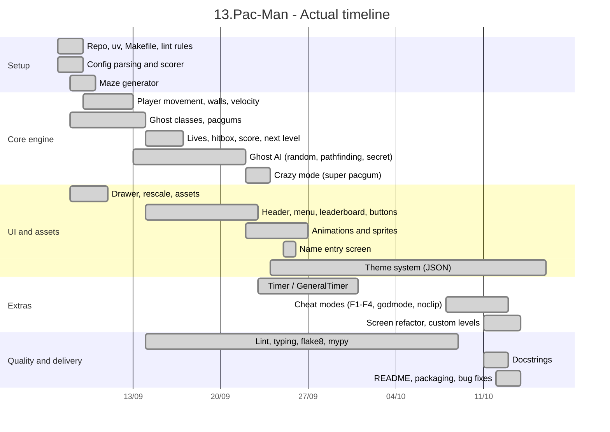

# 01 – Timeline

## Milestones

| Date | Milestone |
|---|---|
| 09-09 | First playable: maze drawn, player moves |
| 09-16 | Score, lives, leaderboard, direction queue |
| 09-23 | Crazy mode, all ghost types, animations |
| 09-25 | Integration of both workstreams (`make run`) |
| 09-30 | JSON theme system |
| 10-09 | Cheat modes, lint clean |
| 10-12 | Docstrings, robustness (config fallback, scorer errors) |
| 10-13 | Packaging, README, final bug fixes |